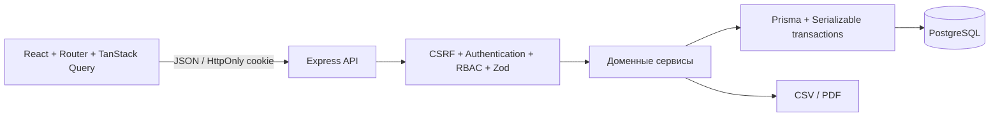

# Архитектура

Приложение — модульный монолит. Vite проксирует /api при разработке, nginx делает то же в Compose. В браузере хранятся только состояния интерфейса и кэш запросов в памяти.

## Backend

`routes/api.ts` связывает HTTP с действиями; `controllers/resources.ts` переиспользует обработку справочников. `validators` проверяет входные поля. `services` содержит бизнес-правила, `repositories/db.ts` — клиент Prisma и повтор транзакций при serialization failure. Middleware аутентификации каждый раз читает сессию, активность пользователя и роль из БД. Изменение присланного role/userId не даёт привилегий.

## Сессии

JWT HS256 с issuer/audience и временем жизни 8 часов хранится в HttpOnly SameSite=Strict cookie. JWT содержит идентификатор серверной сессии; logout и отключение пользователя отзывают доступ. Refresh-токенов нет. Для POST/PUT/PATCH/DELETE проверяются точный Origin и специальный заголовок. Production требует HTTPS и Secure cookie. Секрет проверяется при старте, без небезопасного fallback.

## Доменные правила

Конкурирующая запись в группу, абонементы, посещаемость и финансы используют Serializable с ограниченным повтором P2034. Календарь дополнительно защищён тремя exclusion constraints. Идемпотентный платёж содержит ключ и хэш содержания. Отличающийся повтор с тем же ключом отклоняется. Исправление платежа — отдельный Refund.

## Интерфейс

Страницы разделены по доменам, формы используют RHF+Zod, кнопка реализована как локальный shadcn/ui-компонент с Radix Slot/CVA. Остальные простые элементы — семантические HTML-формы и dialog. Для календаря используется актуальная архитектура FullCalendar 7 (плагины внутри @fullcalendar/react, встроенные часовые пояса). Графики — Recharts. CSS обеспечивает настольную и мобильную компоновку.

## Развитие

`Notification` — сохранённое внутреннее событие с получателем и ключом дедупликации. Будущий outbox/worker может доставлять события в Telegram/email; сейчас внешние сервисы не требуются. `i18n.ts` задаёт точку расширения, но полный перевод всех строк ещё не выполнен.
